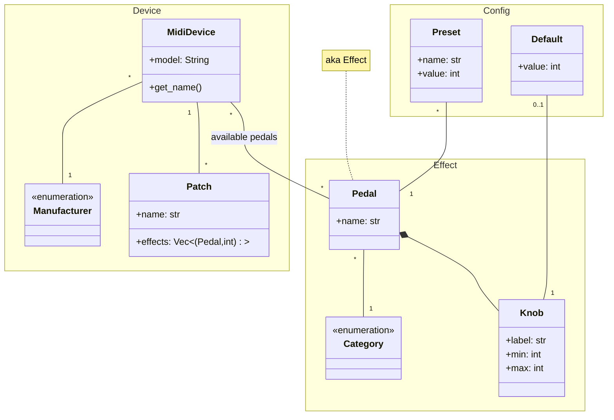

# Design

## Config

It is used to save default values on effects/pedals. Example:
* I want my IR to have a low pass a 12kHz
* It can be used to set default volume levels on various effect

Preset is to name a full pedal/effect config.

## Handle per device

Depending on the model, MIDI CC, SysEx messages, ... can be different.

Rabit holes:
* same manufacturer, same effects: different CC, ID, ...
